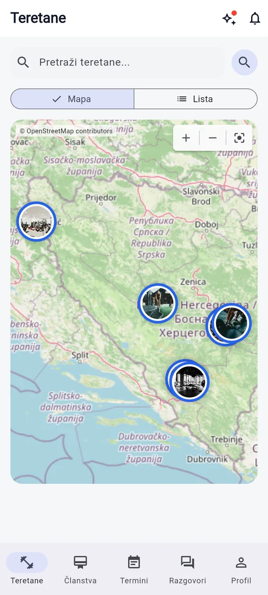
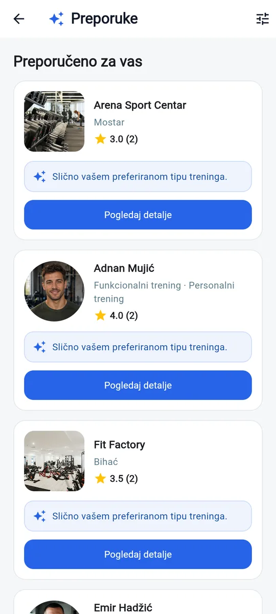
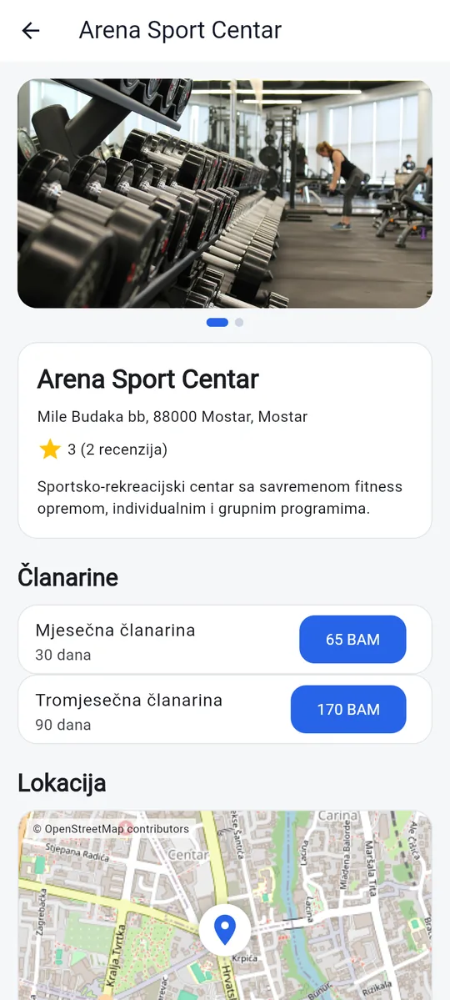
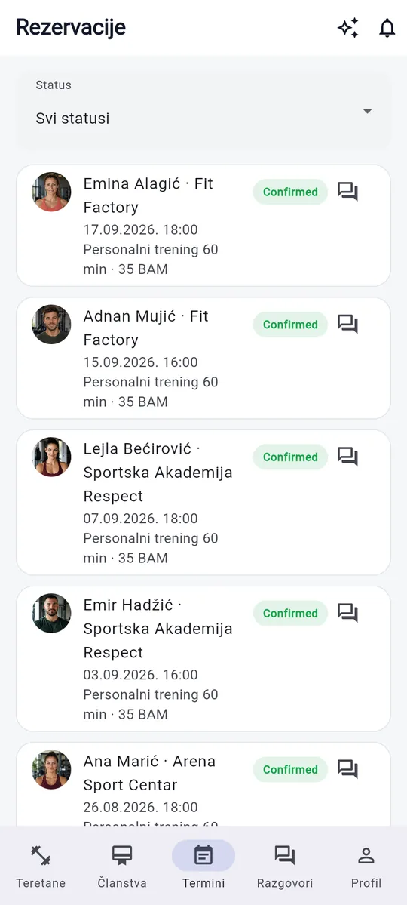
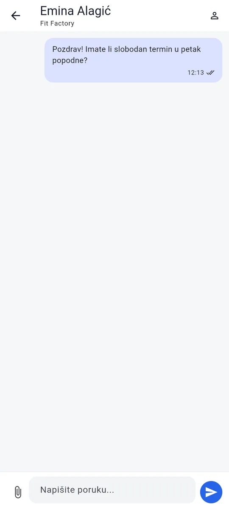
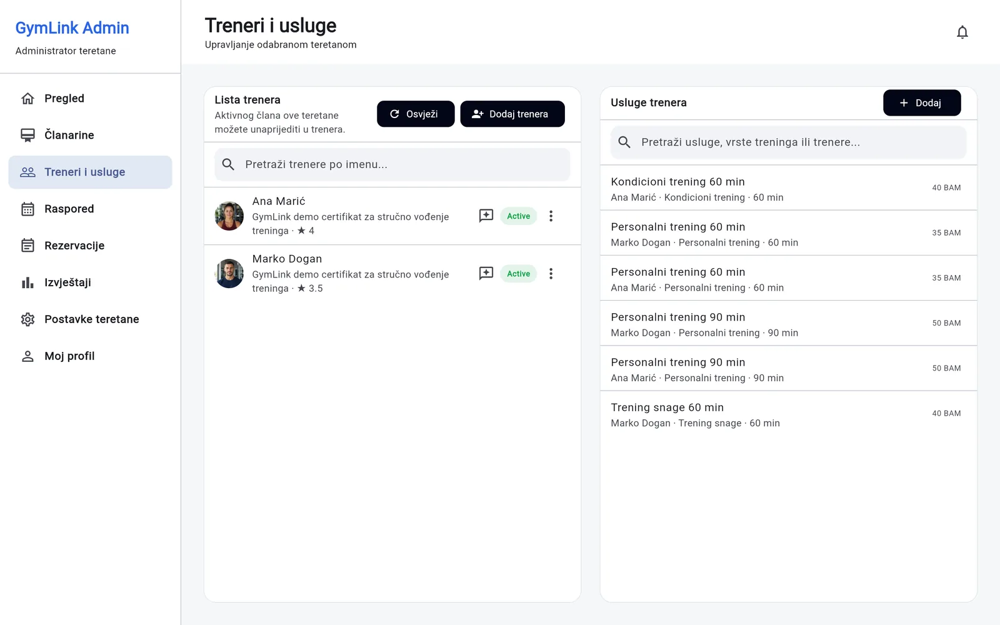
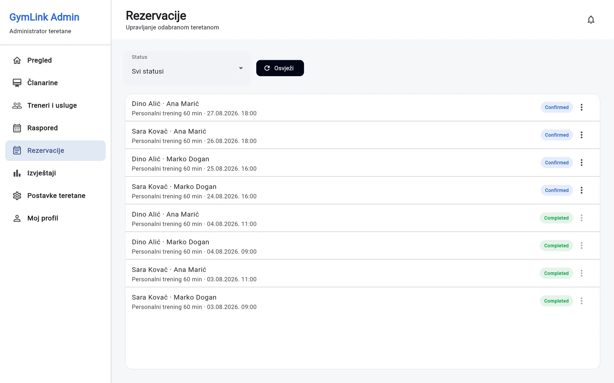
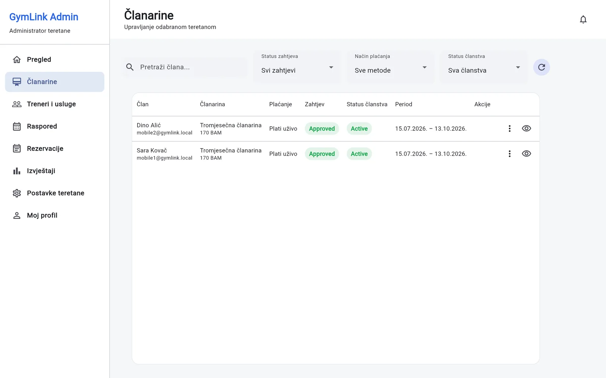
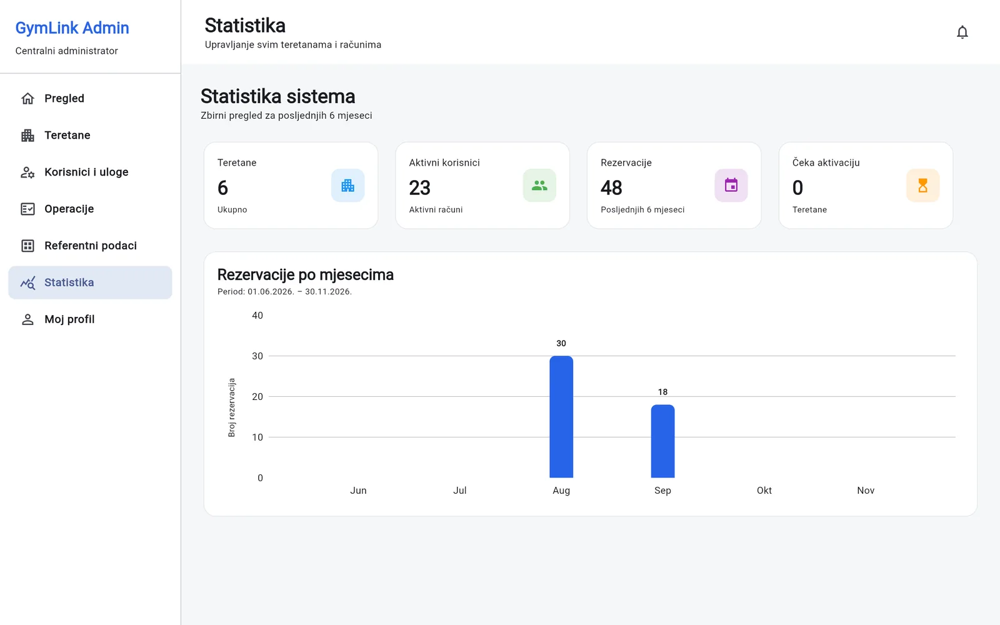
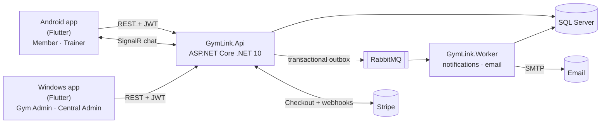

# GymLink


**A gym and personal-training platform.** Members find gyms and trainers, buy memberships, book training
sessions, chat with their trainer and get explained recommendations in an **Android app**. Gym owners and
platform admins run everything from a **Windows desktop app**. Both apps talk to one **ASP.NET Core (.NET 10)
API**, backed by SQL Server and a RabbitMQ-driven background worker.

Built solo by [Anur Zjakić](https://github.com/AnurZ) · [Portfolio](https://anurz.github.io/portfolio/)

## Screenshots

Taken from the running app with the seeded demo data (the UI is in Bosnian).

**Android app (members & trainers)**

| Gym map | Recommendations | Gym details | Reservations | Chat |
|---|---|---|---|---|
|  |  |  |  |  |

**Windows app (gym admins & central admin)**

| Trainers & services | Reservations |
|---|---|
|  |  |
| **Memberships** | **System statistics (central admin)** |
|  |  |

---

## Features

| Role | App | What they can do |
|---|---|---|
| **Member** | Android | Discover gyms and trainers on a map, buy memberships, book trainer appointments (Stripe or pay in person), chat with trainers, review completed services, get personalised recommendations |
| **Trainer** | Android | Manage availability and appointments, chat with members |
| **Gym Admin** | Windows | Manage their gym's members, trainers, schedules, reservations, gallery, statistics and PDF reports |
| **Central Admin** | Windows | Manage gyms and activation, reference data, role assignments and system-wide statistics |

## Architecture



The backend follows **clean architecture**:

```
backend/
  src/
    GymLink.Domain          entities, invariants (no dependencies)
    GymLink.Application     use cases, validation, recommendation scoring, reporting rules
    GymLink.Infrastructure  EF Core, SQL Server, Identity, messaging, Stripe, seeding
    GymLink.Contracts       DTOs / message contracts shared across services
    GymLink.Api             REST controllers, SignalR ChatHub, auth policies
    GymLink.Worker          RabbitMQ consumer, SMTP sender, payment reconciliation
  tests/
    GymLink.Domain.Tests  GymLink.Application.Tests  GymLink.IntegrationTests
ui/
  gymlink_mobile    Flutter Android client (Member, Trainer)
  gymlink_desktop   Flutter Windows client (GymAdmin, CentralAdmin)
```

## Engineering highlights

- **Reliable messaging.** The API writes notification and password-reset messages to a transactional outbox, then
  publishes them to RabbitMQ. The Worker processes them with retries, idempotent handling, manual
  acknowledgements and dead-letter queues for invalid messages.
- **Payments.** Stripe Checkout (sandbox) for memberships and trainer bookings. Each payment is confirmed by
  webhook *and* by checking the Checkout session server-side, and a reconciliation worker catches anything
  missed. Clients always re-read payment status from the API.
- **Real-time chat.** Members and trainers chat over SignalR once a reservation is confirmed.
- **Explainable recommender** (`gymlink-hybrid-v1`). It ranks gyms and trainers by
  0.5 × preference match + 0.3 × personal activity + 0.2 × popularity, re-normalised when a signal is missing,
  so brand-new users still get useful results. Every result carries its algorithm version.
  Details: [recommender-dokumentacija.md](recommender-dokumentacija.md) (Bosnian).
- **Security.** JWT access tokens, refresh sessions kept in encrypted platform storage on the clients, and
  role-based authorization policies. Member endpoints (e.g. recommendations) take the member's identity from
  the validated token, never from the URL or request body.
- **Testing.** About 120 xUnit tests across domain invariants, application rules (scoring, reporting,
  validation, pagination), API integration tests with `WebApplicationFactory`, and architecture tests that
  enforce layer boundaries.

## Tech stack

| Area | Technologies |
|---|---|
| Backend | .NET 10, ASP.NET Core Web API, EF Core, SQL Server 2022, ASP.NET Identity, JWT, SignalR, AutoMapper, QuestPDF, MailKit |
| Messaging | RabbitMQ (transactional outbox, DLQ), background Worker service |
| Payments | Stripe Checkout + webhooks |
| Clients | Flutter / Dart, go_router, provider, flutter_map, fl_chart, signalr_netcore, flutter_secure_storage |
| Testing | xUnit, Microsoft.AspNetCore.Mvc.Testing, coverlet |
| DevOps | Docker, Docker Compose |

---

## Getting started

### 1. Backend (Docker)

Requirements: Docker Desktop.

```bash
cp .env.example .env      # then fill in the values (JWT key, SMTP, Stripe sk_test_..., etc.)
docker compose up --build -d
```

This starts **SQL Server, RabbitMQ, the API and the Worker**. Migrations and demo seeding are controlled by
`Database__MigrateOnStartup` and `GYMLINK_COMPOSE_SEED_ENABLED` in `.env`.

- Swagger: http://localhost:62287/swagger
- RabbitMQ management: http://localhost:15672

Internet access is needed for Gmail SMTP, maps and address search, external gym images and Stripe test payments.

### 2. Clients (Flutter)

```bash
# Android (emulator reaches the host via 10.0.2.2)
cd ui/gymlink_mobile
flutter pub get
flutter run --dart-define=API_BASE_URL=http://10.0.2.2:62287

# Windows desktop
cd ui/gymlink_desktop
flutter pub get
flutter run -d windows --dart-define=API_BASE_URL=http://localhost:62287
```

### 3. Tests

```bash
dotnet test backend/GymLink.sln
```

### Stripe (test mode)

Docker Compose uses real Stripe **sandbox** Checkout. Payments use the `sk_test_...` key from `.env`, open
Stripe Checkout in the browser, and show up in the Stripe test dashboard. Test card: `4242 4242 4242 4242`,
any future expiry date, any CVC. For live webhook delivery run
`stripe listen --forward-to http://localhost:62287/api/webhooks/stripe` and put the `whsec_...` value it prints
into `.env`. The success redirect also verifies the Checkout session directly with Stripe.

---

## Demo accounts

All demo accounts use the password `Test123!`. You can log in with either the username or the email.

<details>
<summary><b>Admins (Windows app)</b></summary>

| Role / Gym | Username |
|---|---|
| Central Admin | `centraladmin` |
| Gym Admin (Arena Sport Centar) | `admin.arena` |
| Gym Admin (Perfect Fit) | `admin.perfectfit` |
| Gym Admin (Sportska Akademija Respect) | `admin.respect` |
| Gym Admin (Oxide Gym) | `admin.oxide` |
| Gym Admin (Fit Factory) | `admin.fitfactory` |
| Gym Admin (Fitness Club Iskra) | `admin.iskra` |

</details>

<details>
<summary><b>Members (Android app)</b></summary>

| Username |
|---|
| `mobile1` |
| `mobile2` |
| `mobile3` |
| `mobile4` |

</details>

<details>
<summary><b>Trainers (Android app)</b></summary>

| Trainer (Gym) | Username |
|---|---|
| Marko Dogan (Arena Sport Centar) | `arenatrainer1` |
| Ana Marić (Arena Sport Centar) | `arenatrainer2` |
| Ivan Kraljević (Perfect Fit) | `perfectfittrainer1` |
| Petra Bošnjak (Perfect Fit) | `perfectfittrainer2` |
| Emir Hadžić (Sportska Akademija Respect) | `respecttrainer1` |
| Lejla Bećirović (Sportska Akademija Respect) | `respecttrainer2` |
| Amar Kovačević (Oxide Gym) | `oxidetrainer1` |
| Selma Delić (Oxide Gym) | `oxidetrainer2` |
| Adnan Mujić (Fit Factory) | `fitfactorytrainer1` |
| Emina Alagić (Fit Factory) | `fitfactorytrainer2` |
| Haris Mehić (Fitness Club Iskra) | `iskratrainer1` |
| Ivana Vuković (Fitness Club Iskra) | `iskratrainer2` |

</details>

---

## License

[MIT](LICENSE) © 2026 Anur Zjakić
